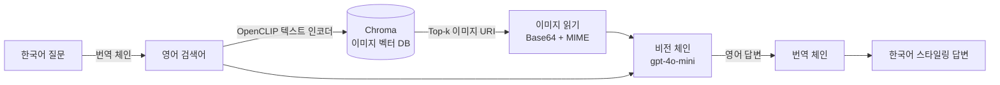

# FashionRAG — 이미지 기반 패션 스타일링 어시스턴트

현대 AI Insight Campus 「멀티모달 AI 활용」 1110 FashionRAG Workshop 실습 저장소입니다.

한국어로 스타일 질문을 하면, 패션 사진 데이터에서 질문과 비슷한 사진을 찾고, 그 사진을 근거로 비전 모델이 한국어 스타일링 조언을 생성합니다. 텍스트 요약을 거치지 않고 **이미지를 직접 임베딩해서 검색하는 멀티모달 RAG** 구조입니다.

## 파이프라인



| 단계 | 함수 | RAG 역할 |
|---|---|---|
| ① 질문 번역 | `translate(query_ko, "English")` | 전처리 |
| ② 이미지 검색 | `query_db(image_vdb, query_en)` | Retrieval |
| ③ 프롬프트 입력 구성 | `format_prompt_inputs(results, query_en)` | Augmentation |
| ④ 답변 생성 | `vision_chain.invoke(prompt_inputs)` | Generation |
| ⑤ 답변 번역 | `translate(response_en, "Korean")` | 후처리 |

## 사용 기술

| 구분 | 사용 | 역할 |
|---|---|---|
| 데이터 | [Fashionpedia](https://huggingface.co/datasets/detection-datasets/fashionpedia) (`train`) | 패션 사진 300장을 스트리밍으로 받아 저장 |
| 임베딩 | OpenCLIP ViT-B-32 (`laion2b_s34b_b79k`) | 텍스트와 이미지를 같은 512차원 공간의 벡터로 변환 |
| 벡터 DB | Chroma (`PersistentClient`) | 이미지 벡터·ID·경로(URI) 저장, 가까운 이미지 검색 |
| LLM | OpenAI `gpt-4o-mini` | 한↔영 번역, 이미지를 보고 스타일링 답변 생성 |
| 체인 | LangChain LCEL | `prompt \| model \| parser` 로 번역·비전 체인 구성 |

## 폴더 구조

```
fashionRAG-assistant/
├── FashionRAG_멀티모달RAG_수업.ipynb   # 실습 노트북 (실행 결과 포함)
├── requirements.txt
├── .gitignore
├── README.md
├── .env               # OpenAI API 키 (저장소에 포함하지 않음)
├── fashion_dataset/   # 다운로드한 이미지 300장 (저장소에 포함하지 않음)
└── img_vdb/           # Chroma 벡터 DB (저장소에 포함하지 않음)
```

이미지와 벡터 DB는 용량이 크고 노트북을 실행하면 다시 만들어지므로 저장소에 올리지 않았습니다. 결과는 노트북 출력 셀에서 확인할 수 있습니다.

## 실행 방법

1. 가상환경을 만들고 패키지를 설치합니다. (Python 3.11)

   ```powershell
   python -m venv .venv
   .venv\Scripts\activate
   pip install -r requirements.txt
   ```

2. 프로젝트 폴더에 `.env` 파일을 만들고 API 키를 넣습니다.

   ```
   OPENAI_API_KEY=sk-...
   ```

3. 노트북을 위에서부터 순서대로 실행합니다.
   - 첫 실행 시 Fashionpedia 이미지 300장을 내려받고, OpenCLIP 가중치(약 600MB)를 내려받아 이미지를 임베딩합니다. CPU 기준 몇 분이 걸립니다.
   - 이미 받은 이미지와 등록된 벡터는 건너뜁니다.

## 노트북 구성

| Part | 내용 |
|---|---|
| Part 1 | 환경 설정, API 키, 설정값, 보조 함수(이미지 목록·썸네일 그리드·MIME 추정) |
| Part 2 | Fashionpedia 스트리밍 다운로드, `image_0001.jpg` 형식으로 JPEG 저장 |
| Part 3 | OpenCLIP + Chroma 컬렉션 생성, 이미지 등록, 텍스트로 이미지 검색 |
| Part 4 | 번역 체인, 비전 체인(텍스트 블록 1개 + 이미지 블록 2개) |
| Part 5 | 전체 파이프라인 `ask_fashion_rag()`, 대화형 모드 |
| Part 6 | 실습 문제 1~4 |

## 실습 문제

| 실습 | 내용 | 핵심 |
|---|---|---|
| 1. 검색 개수 바꾸기 | `"a black leather jacket"` 과 비슷한 사진 4장 검색 | `n_results` 로 Top-k 조절 |
| 2. 이미지로 이미지 검색 | 첫 번째 이미지를 검색어로 비슷한 사진 검색 | `query_texts` 대신 `query_uris` 사용, CLIP 이미지 인코더로 검색 |
| 3. 페르소나 바꾸기 | 가성비 스타일리스트 체인 만들기 | user 메시지는 그대로 두고 system 메시지만 교체 |
| 4. 거리 임계값 필터 | distance 가 기준 이하인 결과만 남기기 | 관련 없는 사진을 LLM 에 보내지 않기 위한 장치 |

## 실행하며 알게 된 점

**한국어로는 검색이 잘 되지 않는다.**
`"a blue shirts"` 는 1위 image_0203(거리 0.7372), `"파란 셔츠"` 는 1위 image_0136(거리 0.7506)으로 결과가 완전히 달랐지만 거리는 거의 같았습니다. 이 OpenCLIP 가중치는 영어 캡션으로 학습되어 한국어 문장을 제대로 된 의미 벡터로 만들지 못합니다. 그래서 검색 전에 질문을 영어로 번역합니다.

**거리 값은 설명과 다르게 코사인 거리였다.**
노트북 설명은 Chroma 기본 거리가 제곱 유클리드(L2²)라고 했지만, 실제 출력은 0.73~0.76이었습니다. L2²라면 1.4~1.6 근처가 나와야 하므로 이 값은 코사인 거리(1 − 코사인 유사도)에 해당합니다. 그래서 실습 4의 기본 기준값 `1.5` 는 모든 결과를 통과시키며, 0.75 전후로 잡아야 필터가 의미를 가집니다.

**Top-k 는 관련이 없어도 항상 k장을 돌려준다.**
"가을에 입기 좋은 남자 트렌치코트 스타일링 알려줘" 로 실행했을 때 검색된 두 장(블레이저, 데님 셔츠)에 트렌치코트가 없었는데도 모델은 그 사진을 근거로 조언했습니다. 거리 기준 필터나, 사진이 질문과 맞지 않으면 그 사실을 밝히도록 하는 프롬프트가 필요합니다.

**질문 번역이 검색어로는 어색했다.**
같은 질문이 `Here are some styling tips for men's trench coats...` 처럼 "알려줘" 까지 답변처럼 번역되어, 짧은 검색어가 아니라 긴 문장이 CLIP 에 들어갔습니다. 한국어 질문을 `a man wearing a trench coat` 같은 짧은 영어 검색어로 바꾸는 체인을 따로 두면 검색 의도가 더 분명해집니다.

**벡터 DB 에는 이미지의 절대 경로가 저장된다.**
프로젝트 폴더를 옮긴 뒤에도 검색 결과 경로가 예전 폴더를 가리켰습니다. 이미 등록된 ID 는 건너뛰도록 되어 있어 경로가 갱신되지 않았기 때문입니다. 폴더를 옮기면 `img_vdb/` 를 지우고 다시 등록해야 합니다.

## 한계와 개선 방향

- **데이터 규모**: 이미지가 300장뿐이라 질문에 맞는 옷이 아예 없을 수 있습니다. 이미지 수를 늘리면 검색 품질이 좋아지지만 임베딩 시간이 늘어납니다.
- **다국어 CLIP**: `xlm-roberta-base-ViT-B-32` 같은 다국어 모델을 쓰면 번역 없이 한국어로 바로 검색할 수 있습니다.
- **메타데이터 필터**: Fashionpedia 의 의류 카테고리 주석을 `metadatas` 로 저장하면 `where={"category": ...}` 로 종류별 검색이 가능합니다.
- **고정된 이미지 수**: 비전 프롬프트가 이미지 2장을 고정으로 받으므로, 거리 필터 후 남은 장수에 맞춰 이미지 블록을 만들도록 바꿀 수 있습니다.

## 데이터 출처

Fashionpedia — [detection-datasets/fashionpedia](https://huggingface.co/datasets/detection-datasets/fashionpedia) (CC BY 4.0)
